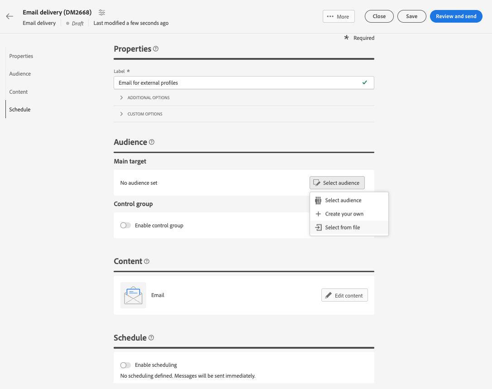
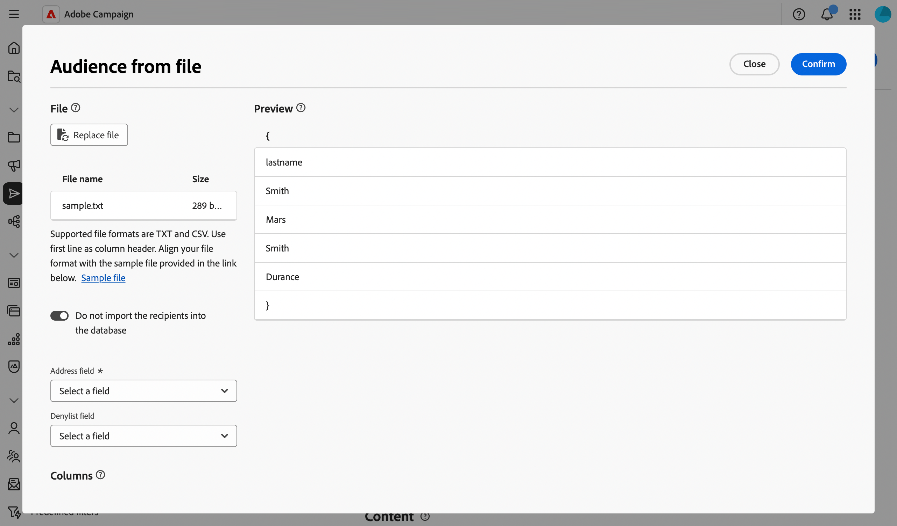
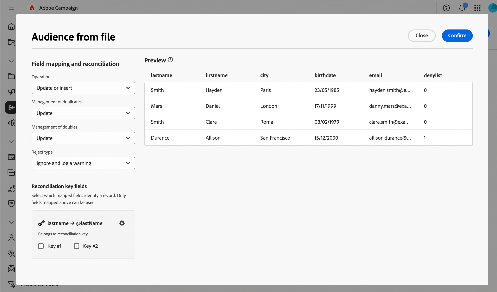
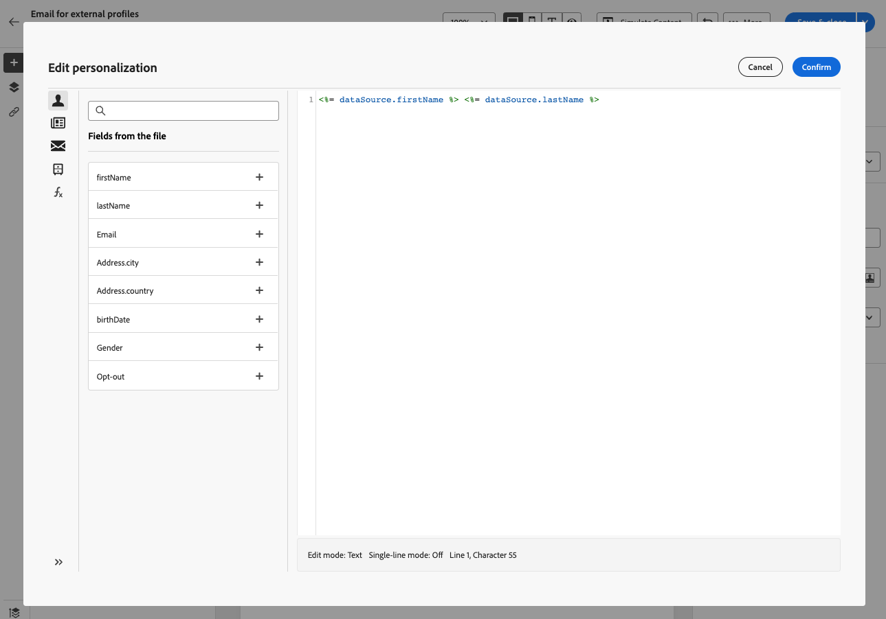
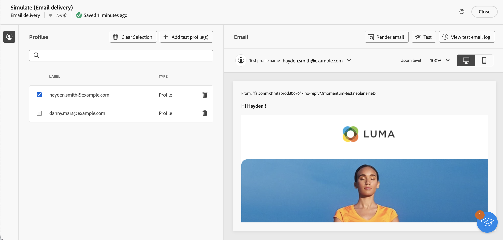
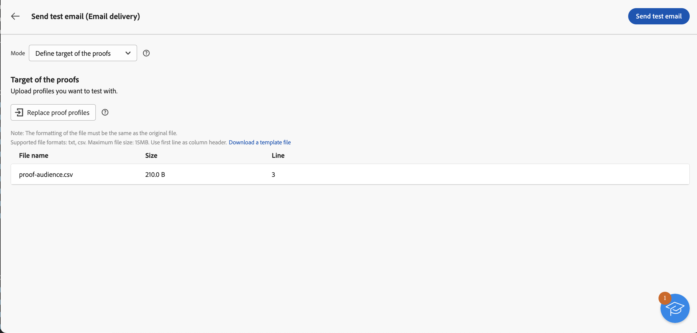

# 파일에서 이메일 대상자 로드 {#audience-from-file}

>[!CONTEXTUALHELP]
>id="acw_audience_fromfile_select"
>title="파일 선택"
>abstract="업로드할 로컬 파일을 선택합니다. 지원되는 형식은 TXT 및 CSV입니다. 파일 형식을 아래 링크된 샘플 파일에 일치시킵니다."

>[!CONTEXTUALHELP]
>id="acw_audience_fromfile_columns"
>title="열 정의"
>abstract="외부 파일의 열 형식을 확인합니다."

>[!CONTEXTUALHELP]
>id="acw_audience_fromfile_formatting"
>title="서식 지정 매개변수"
>abstract="데이터를 올바르게 가져올 수 있도록 외부 파일의 형식을 지정하는 방법을 지정합니다."

>[!CONTEXTUALHELP]
>id="acw_audience_fromfile_preview"
>title="파일 미리보기"
>abstract="외부 파일의 열 미리보기를 확인합니다. 이 화면에는 최대 30개까지의 레코드만 표시됩니다."

Adobe Campaign 웹 사용자 인터페이스를 사용하면 외부 파일에 저장된 프로필을 타겟팅할 수 있습니다. 프로필이 로드되면 입력 파일의 모든 필드를 사용하여 게재를 개인화할 수 있습니다. [콘텐츠 개인화 방법 알아보기](../personalization/personalize.md).

데이터베이스에 프로필을 추가하지 않고 이 특정 독립 실행형 이메일 게재에 대한 프로필만 로드하도록 선택하거나, 해당 프로필을 데이터베이스에 가져와 조정하도록 선택할 수 있습니다. [자세히 알아보기](#upload).

>[!NOTE]
>
>이 페이지에서는 독립형 이메일 게재를 만들 때 파일에서 외부 프로필을 로드하는 방법을 설명합니다. 워크플로우 컨텍스트에서 파일에서 데이터를 로드하려면 [이 페이지](../workflows/activities/load-file.md)를 참조하세요.

## 반드시 알아야 할 사항 {#must-read}

* 이 기능은 **이메일 게재**&#x200B;에만 사용할 수 있습니다.
* 지원되는 파일 형식은 텍스트(TXT) 및 쉼표로 구분된 값(CSV)입니다.
* 외부 파일에서 대상 모집단을 로드하면 [컨트롤 그룹](control-group.md)을 사용할 수 없습니다.

## 입력 파일 선택 및 구성 {#upload}

이메일에 있는 파일의 프로필을 타겟팅하려면 다음 단계를 수행합니다.

1. 기존 전자 메일 게재를 열거나 [새 전자 메일 게재를 만듭니다](../email/create-email.md).
1. **대상** 섹션에서 **대상 선택** 단추를 클릭한 다음 **파일에서 선택**&#x200B;을 선택합니다.

   {zoomable="yes"}

1. 로드할 로컬 파일을 선택합니다. 파일 형식은 [샘플 파일](#sample-file)과(와) 일치해야 합니다.
1. 화면 중앙 섹션에서 데이터가 매핑되는 방식을 미리 보고 확인합니다.

   

1. **주소 필드** 드롭다운 목록에서 전자 메일 주소를 포함하는 열을 지정하십시오. 입력 파일에 이러한 정보가 있으면 차단 목록에 추가하다 열을 선택할 수도 있습니다.
1. **[!UICONTROL 열]** 섹션에서 열을 확장하여 해당 설정을 조정하고 사용 가능한 옵션을 사용하여 데이터 형식을 지정하는 방법을 정의합니다. 조정에 사용할 각 열에 대해 **[!UICONTROL 대상 필드 선택]**&#x200B;을 사용하여 받는 사람 스키마 특성에 매핑합니다.

1. **[!UICONTROL 수신자를 데이터베이스로 가져오지 않음]** 스위치를 사용하여 파일의 프로필을 가져와서 데이터베이스로 조정할지 여부를 제어합니다. 가져오기를 선택하면 **[!UICONTROL 필드 매핑 및 조정]** 섹션이 표시됩니다. 다음 매개 변수를 구성합니다.

   

   +++**[!UICONTROL 작업]**

   데이터베이스에서 수행할 작업을 선택합니다.

   * **[!UICONTROL 업데이트 또는 삽입]**: 데이터베이스에 레코드가 있으면 업데이트하고 없으면 만듭니다.
   * **[!UICONTROL 삽입]**: 데이터베이스에 레코드를 삽입합니다.
   * **[!UICONTROL 업데이트]**: 기존 레코드만 업데이트합니다.
   * **[!UICONTROL 조정만]**: 데이터베이스에서 레코드를 검색하지만 업데이트를 수행하지 않습니다.
   * **[!UICONTROL 삭제]**: 데이터베이스에서 레코드를 삭제합니다.

   +++

   +++**[!UICONTROL 중복 항목 관리]**

   파일과 데이터베이스에 모두 존재하는 레코드를 처리하는 방법을 선택합니다.

   * **[!UICONTROL 업데이트]**(기본값): 레코드를 업데이트합니다.
   * **[!UICONTROL 엔티티 거부]**: 제외하며 오류를 기록합니다.
   * **[!UICONTROL 무시]**: 추적을 유지하지 않고 제외합니다.

   +++

   +++**[!UICONTROL double 관리]**

   파일 자체에 두 번 이상 나타나는 레코드를 처리하는 방법을 선택합니다.

   * **[!UICONTROL 업데이트]**(기본값): 중복 제거되지 않습니다. 마지막으로 일치하는 레코드의 우선 순위를 사용합니다.
   * **[!UICONTROL 엔티티 거부]**: 추가 레코드를 제외하며 오류를 기록합니다.
   * **[!UICONTROL 무시]**: 추적을 유지하지 않고 추가 레코드를 제외합니다.

   +++

   +++**[!UICONTROL 거부 유형]**

   조정 중에 필드 수준 오류를 처리하는 방법 선택:

   * **[!UICONTROL 경고 무시 및 기록]**: 다른 모든 필드를 가져오고 오류를 기록합니다.
   * **[!UICONTROL 부모 요소 거부]**: 전체 레코드를 거부합니다.
   * **[!UICONTROL 모든 요소 거부]**: 가져오기를 중지하고 모든 요소를 거부합니다.

   +++

   +++**[!UICONTROL 조정 키 필드]**

   **[!UICONTROL 열]** 섹션에서 일부 열을 대상 필드에 매핑했습니다. 여기에서 매핑된 필드 중 레코드를 식별하는 데 사용할 필드를 선택합니다.

   +++

1. **[!UICONTROL 서식]** 섹션에서 파일에서 사용하는 인코딩, 문자열 구분 기호 및 열 구분 기호를 지정합니다.
1. 설정이 적절하면 **확인**&#x200B;을 클릭합니다.

메시지 콘텐츠를 만들 때 입력 파일의 필드를 활용하여 개인화를 추가합니다. [콘텐츠 개인화 방법 알아보기](../personalization/personalize.md)

{zoomable="yes"}

## 샘플 파일 {#sample-file}

>[!CONTEXTUALHELP]
>id="acw_audience_fromfile_samplefile"
>title="파일에서 대상자 로드"
>abstract="지원되는 파일 형식은 TXT 및 CSV입니다. 첫 번째 라인을 열 머리글로 사용합니다. 파일 형식을 아래 링크에서 확인할 수 있는 샘플 파일에 일치시킵니다."

게재의 타겟 프로필에 외부 파일을 로드할 때 입력 파일이 아래 권장 사항과 일치하는지 확인하십시오.

* 지원되는 형식은 TXT 및 CSV입니다.
* 파일의 첫 번째 줄은 열 머리글입니다.
* 파일 형식을 아래의 샘플 파일과 일치시키십시오.

  ```
  lastname,firstname,city,birthdate,email,denylist
  Smith,Hayden,Paris,23/05/1985,hayden.smith@example.com,0
  Mars,Daniel,London,17/11/1999,danny.mars@example.com,0
  Smith,Clara,Roma,08/02/1979,clara.smith@example.com,0
  Durance,Allison,San Francisco,15/12/2000,allison.durance@example.com,1
  ```

## 이메일 미리 보기 및 테스트 {#test}

Campaign 웹을 사용하면 파일에서 업로드한 대상자를 사용할 때 증명을 미리 보고 보낼 수 있습니다. 이렇게 하려면 다음 단계를 수행합니다.

1. 게재 콘텐츠 편집 화면에서 **[!UICONTROL 콘텐츠 시뮬레이션 단추]**&#x200B;를 클릭하고 **[!UICONTROL 테스트 프로필 추가]** 단추를 클릭합니다.

1. 업로드된 파일에 포함된 프로필이 표시됩니다. 콘텐츠를 미리 보는 데 사용할 프로필을 선택하고 **[!UICONTROL 선택]**&#x200B;을 클릭합니다.

1. 게재 콘텐츠 미리보기가 화면의 오른쪽 창에 표시됩니다. 개인화된 요소는 왼쪽 창에서 선택한 프로필의 데이터로 바뀝니다. [게재 콘텐츠 미리 보기에 대해 자세히 알아보기](../preview-test/preview-content.md)

   {zoomable="yes"}

1. 증명을 보내려면 **[!UICONTROL 증명 보내기]** 단추를 클릭하세요.

1. **[!UICONTROL 증명 프로필 업로드]** 단추를 클릭하고 증명 수신자가 포함된 .txt 또는 .csv 파일을 선택합니다.

   >[!CAUTION]
   >
   >파일 형식이 대상자를 업로드하는 데 사용된 형식과 일치하는지 확인합니다. 형식 오류가 발생하면 경고가 표시됩니다.

1. 증명 프로필이 추가되어 증명을 보낼 준비가 되면 **[!UICONTROL 증명 보내기]** 단추를 클릭하고 보내기를 확인합니다.

   증명 전송 프로세스를 보여 주는 {zoomable="yes"}

1. 언제든지 **[!UICONTROL 증명 보기]** 단추를 사용하여 증명 전송을 모니터링합니다. [증명 모니터링에 대해 자세히 알아보기](../preview-test/test-deliveries.md#access-test-deliveries)