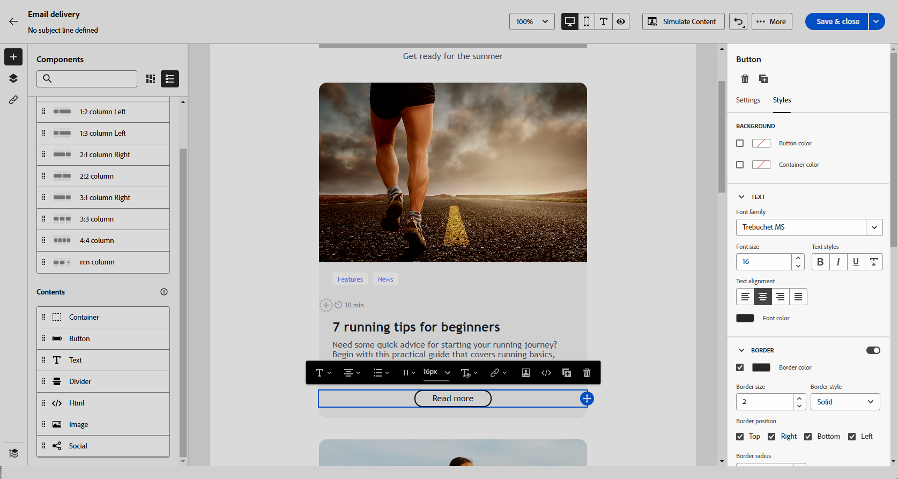

# 이메일 스타일 시작하기 {#get-started-email-style}

[!DNL Adobe Campaign]에서 전자 메일 콘텐츠를 만들기 시작하면 전자 메일 Designer 설정 창에서 여러 스타일 매개 변수와 특성을 조정할 수 있습니다.

이메일 본문, 구조 구성 요소 또는 콘텐츠 구성 요소에 변경 사항을 적용할 수 있습니다.

{zoomable="yes"}

아래 링크를 통해 이메일의 일부 스타일 설정을 조정하는 방법을 알아보십시오.

* [이메일 배경 개인화](backgrounds.md) 방법 알아보기
* [수직 정렬 및 패딩 관리](alignment-and-padding.md) 방법 알아보기
* [이메일에서 링크 스타일을 정의](styling-links.md)하는 방법 알아보기
* [인라인 스타일 속성을 사용자 정의](inline-styling.md)하는 방법 알아보기
