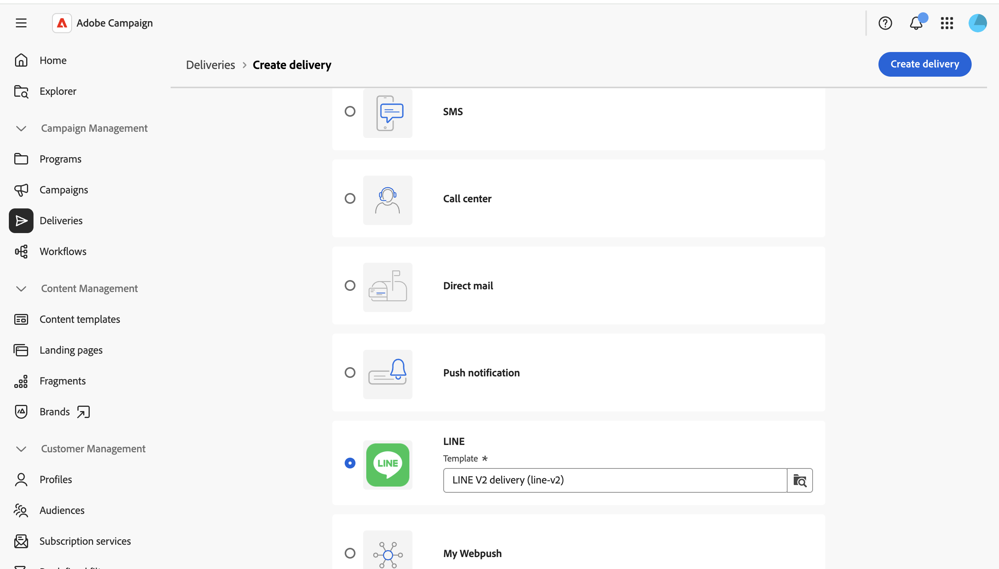
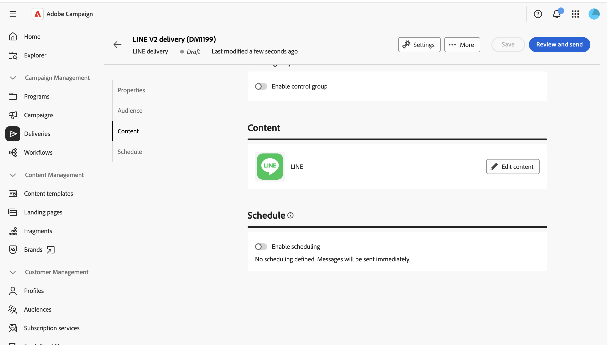
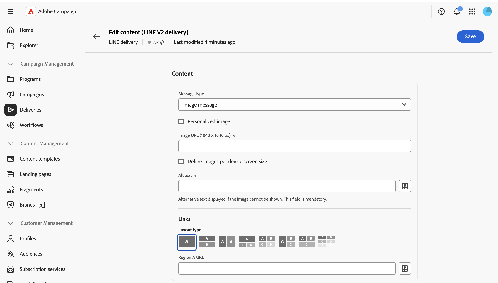
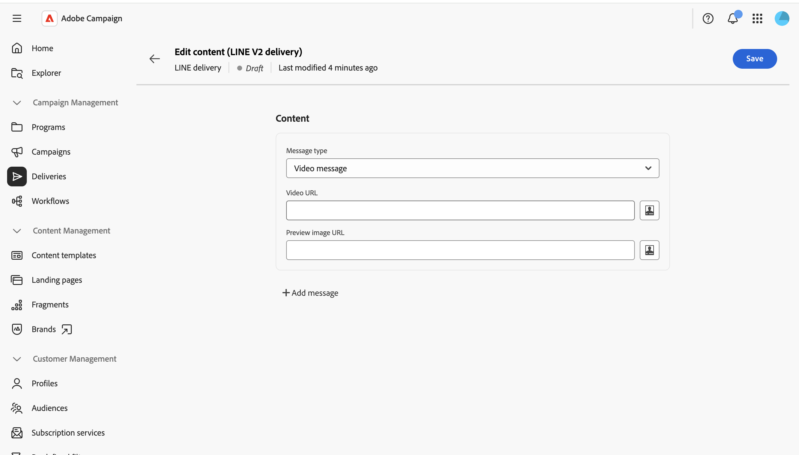

# LINE 메시지 보내기 {#send-line}

텍스트, 이미지 또는 비디오 콘텐츠를 사용하여 LINE 메시지를 만들어 구독자에게 보낼 수 있습니다. LINE 게재를 독립 실행형 게재로 생성하거나 워크플로우에 추가할 수 있습니다.

이 페이지는 독립형 LINE 게재를 작성하는 과정을 안내하지만 워크플로우에서 LINE 채널 활동을 구성하는 경우에도 동일한 단계가 적용됩니다.

>[!IMPORTANT]
>
>LINE 게재에는 현재 메시지 미리 보기가 지원되지 않습니다. 렌더링된 메시지를 미리 볼 수 없으므로 보내기 전에 편집기에서 콘텐츠를 주의 깊게 검토하십시오.

## LINE 게재 만들기 {#create-line-delivery}

1. **[!UICONTROL 게재]** 메뉴로 이동한 다음 **[!UICONTROL 게재 만들기]**&#x200B;를 클릭합니다.

1. **[!UICONTROL LINE]**&#x200B;을(를) 선택하고 기본 **[!UICONTROL LINE V2 게재]** 템플릿과 같은 게재 템플릿을 선택하십시오. [템플릿에 대해 자세히 알아보기](../msg/delivery-template.md).

   

1. **[!UICONTROL 게재 만들기]**&#x200B;를 클릭하여 게재 구성 화면을 확인하고 표시합니다.

1. 게재할 **[!UICONTROL 레이블]**&#x200B;을(를) 입력하고 필요한 경우 추가 또는 사용자 지정 옵션을 정의합니다. [자세히 알아보기](../push/create-push.md#configure-push-settings).

   

## 대상자 선택 {#audience}

1. 기존 대상을 타깃팅하거나 만들려면 **[!UICONTROL 대상 선택]**&#x200B;을 클릭하세요. LINE 게재 타깃팅은 **[!UICONTROL 방문자 구독]**&#x200B;을(를) 기반으로 합니다. [대상자에 대해 자세히 알아보기](../audience/about-recipients.md).

1. 컨트롤 그룹을 설정하고 게재의 영향을 측정하려면 **[!UICONTROL 컨트롤 그룹 사용]** 옵션을 켜십시오. 메시지는 해당 컨트롤 그룹으로 전송되지 않으므로 메시지를 받은 모집단의 동작을 받지 않은 연락처의 동작과 비교할 수 있습니다. [자세히 알아보기](../audience/control-group.md)

## 콘텐츠 정의 {#content}

**[!UICONTROL 콘텐츠 편집]**&#x200B;을 클릭합니다.

LINE 콘텐츠 편집기가 표시됩니다.

LINE 게재에는 최대 5개의 메시지가 포함될 수 있습니다. 게재에 다른 메시지를 추가하려면 **[!UICONTROL 메시지 추가]**&#x200B;를 클릭하고 삭제하려면 **[!UICONTROL 메시지 제거]**&#x200B;를 클릭하십시오.

사용 가능한 경우 개인화 편집기를 사용하여 다이내믹 콘텐츠를 삽입할 수 있습니다. [자세히 알아보기](../personalization/personalize.md).

각 메시지는 다음 유형 중 하나를 사용합니다.

>[!NOTE]
>
>이미지 및 비디오 URL만 지원됩니다. 클라이언트 콘솔의 동작과 일치하는 로컬 파일을 업로드할 수 없습니다.

### 텍스트 메시지 {#text-message}

문자 메시지는 문자 형태로 보내는 간단한 메시지입니다. 관련 필드에 메시지를 입력하고 필요한 경우 개인화 필드를 사용하면 됩니다.

### 이미지 메시지 {#image-message}

이미지 메시지를 사용하면 클릭 가능한 영역으로 선택적으로 구분된 이미지를 보낼 수 있으며 각 이미지는 서로 다른 URL에 연결됩니다.

* **[!UICONTROL 개인화된 이미지]**: 받는 사람별로 이미지를 동적으로 정의합니다.
* **[!UICONTROL 이미지 URL]**: 이미지의 URL을 제공합니다. 권장 크기는 1040 x 1040픽셀입니다. **[!UICONTROL 장치 화면 크기별 이미지 정의]**&#x200B;를 사용하여 화면 크기별로 최적화된 다양한 이미지 해상도를 제공합니다.
* **[!UICONTROL 대체 텍스트]**: 이미지를 로드할 수 없는 경우 필수 대체 텍스트가 표시됩니다.
* **[!UICONTROL 링크]**: 하나 이상의 클릭 가능한 영역으로 이미지를 분할할 레이아웃을 선택한 다음 각 영역에 URL을 지정하십시오.

### 비디오 메시지 {#video-message}

비디오 메시지를 사용하면 수신자에게 비디오를 보낼 수 있습니다.

* **[!UICONTROL 비디오 URL]**: 비디오의 URL입니다. MP4 형식만 지원됩니다.
* **[!UICONTROL 미리 보기 이미지 URL]**: 비디오가 재생되기 전에 표시되는 이미지의 URL입니다.

## 예약 및 보내기 {#schedule-send}

1. 콘텐츠를 정의한 후 **저장**&#x200B;을 클릭한 다음 뒤로 아이콘을 클릭하여 게재 구성 화면으로 돌아갑니다.

1. 특정 날짜 및 시간에 보내려면 **[!UICONTROL 일정 조정 사용]**&#x200B;을 사용하도록 설정하십시오. [자세히 알아보기](../msg/create-deliveries.md#gs-schedule).

   

1. 콘텐츠가 준비되면 **[!UICONTROL 검토 및 보내기]**&#x200B;를 클릭하세요. 게재 대시보드가 열립니다.

   

1. **[!UICONTROL 준비]**&#x200B;를 클릭한 다음 확인합니다. 오류가 있으면 수정하고 **[!UICONTROL 준비]**&#x200B;를 다시 클릭합니다.

1. **[!UICONTROL 보내기]**&#x200B;를 클릭합니다. 그런 다음 게재 **[!UICONTROL 보고서]** 및 **[!UICONTROL 로그]** 진입점의 결과를 추적할 수 있습니다.
