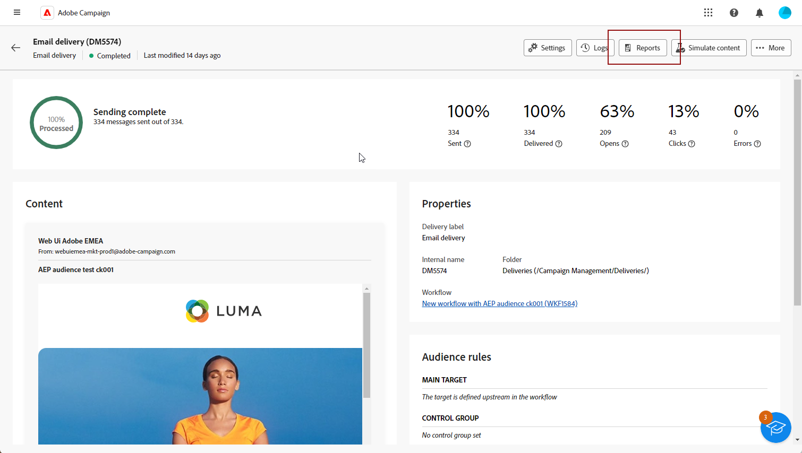
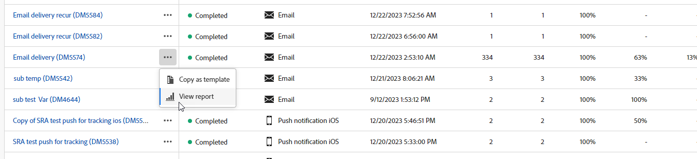
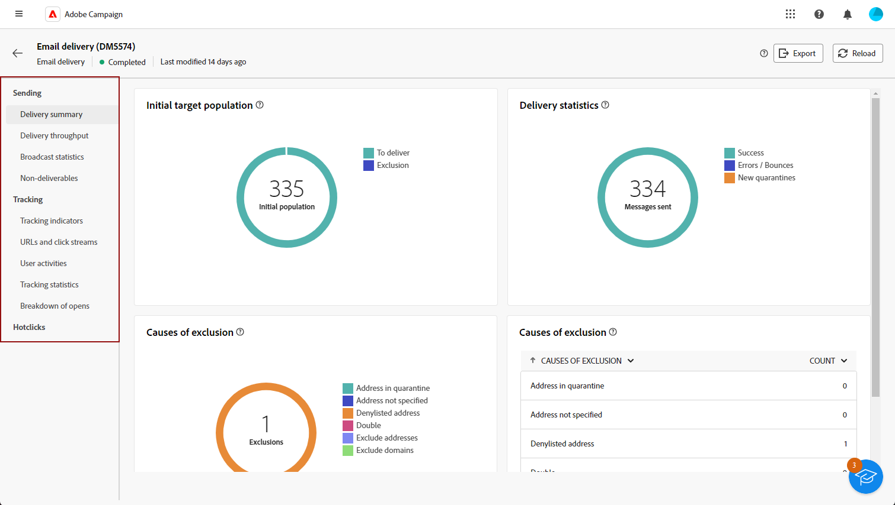
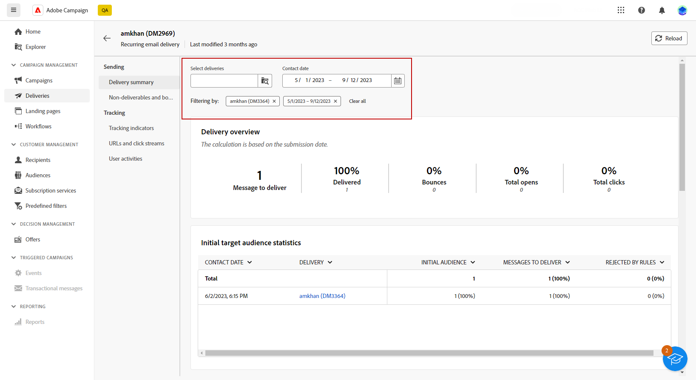
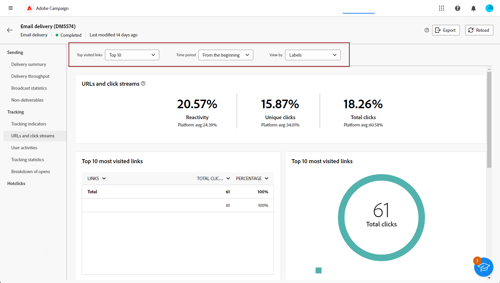

# 게재 보고서 시작하기 {#reports}

>[!CONTEXTUALHELP]
>id="acw_campaign_reporting_deliveries_selection"
>title="집계된 게재 보고"
>abstract="집계된 데이터 보고서를 표시하려면 두 개 이상의 게재를 선택합니다."

**게재 보고서**&#x200B;는 각 채널 전반의 **게재**&#x200B;에만 초점을 맞춘 심층적인 인사이트와 데이터를 제공합니다. 이러한 보고서는 개별 게재의 성능, 효율성 및 결과에 대한 자세한 정보를 제공하며 포괄적인 개요를 제공합니다.

각 채널에 대한 보고서 및 관련 지표의 전체 목록은 다음 페이지에서 사용할 수 있습니다.

* [이메일 게재 보고서](email-report.md)
* [SMS 게재 보고서](sms-report.md)
* [푸시 게재 보고서](push-report.md)
* [DM 게재 보고서](direct-mail.md)

## 보고서 대시보드 관리 {#manage-reports}

Adobe Campaign은 각 게재에 대해 액세스할 수 있는 여러 유형의 보고서를 제공합니다. 이러한 보고서는 기본 제공 대시보드에서 메시지의 영향과 성능을 측정하고 시각화합니다.

보고서를 표시하고 관리하려면 다음 단계를 수행합니다.

1. 특정 게재에 대한 보고서를 생성하려면 **[!UICONTROL 게재]** 메뉴로 이동한 다음 보고할 게재를 선택합니다.

1. **[!UICONTROL 게재]** 대시보드에서 **[!UICONTROL 보고서]**&#x200B;를 클릭합니다.

   {zoomable="yes"}

   또는 게재 목록에서 게재 이름 옆에 있는 세 점 **추가 작업** 단추를 사용하고 **[!UICONTROL 보고서 보기]**&#x200B;를 선택합니다.

   {zoomable="yes"}

1. 왼쪽 메뉴의 목록에서 보고서를 선택합니다.

   {zoomable="yes"}

1. 게재가 반복되는 경우 **[!UICONTROL 게재 선택]**&#x200B;을 클릭하여 보고할 특정 게재를 선택하십시오.

   **[!UICONTROL 연락 날짜]**&#x200B;를 선택하여 보고서에 기간을 적용할 수도 있습니다.

   {zoomable="yes"}

1. **[!UICONTROL URL 및 클릭 스트림]**&#x200B;에서 **[!UICONTROL 가장 많이 방문한 링크]** 또는 **[!UICONTROL 기간]**&#x200B;을 선택하세요.

   **[!UICONTROL 보기 기준]** 옵션을 사용하면 URL, 레이블 또는 범주를 필터링할 수 있습니다.

   {zoomable="yes"}

>[!CONTEXTUALHELP]
>id="acw_delivery_reporting_line_deliveries_overview"
>title="LINE 게재 개요"
>abstract="LINE 게재에 대한 게재 메시지, 게재된 메시지 및 게재 오류를 봅니다."

>[!CONTEXTUALHELP]
>id="acw_delivery_reporting_line_targeted_population"
>title="LINE 타겟팅된 모집단"
>abstract="**대상 모집단** 그래프 및 표는 LINE 대상자를 기준으로 데이터를 표시합니다. 전달할 메시지 및 제외."

>[!CONTEXTUALHELP]
>id="acw_delivery_reporting_line_overall_stats"
>title="LINE 전체 통계"
>abstract="**전체 통계** 보고서는 보낸 LINE 메시지에 대한 데이터를 제공합니다(성공 및 오류)."

>[!CONTEXTUALHELP]
>id="acw_delivery_reporting_line_exclusions"
>title="LINE 제외"
>abstract="**제외** 그래프 및 표에는 제외된 프로필에서 LINE 메시지를 받지 못하게 하는 이유가 표시됩니다."

>[!CONTEXTUALHELP]
>id="acw_delivery_reporting_throughput_line"
>title="LINE 게재 처리량"
>abstract="**게재 처리량** 보고서는 지정된 기간 내에 LINE 메시지의 게재 속도를 제공합니다."
