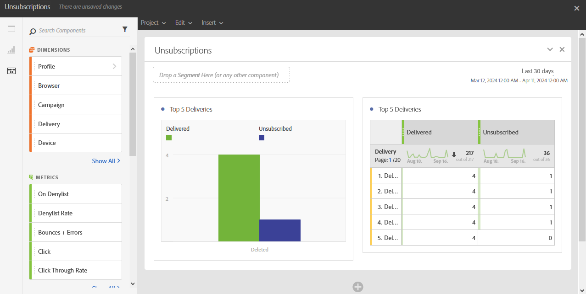

# 구독 취소 건수{#unsubscriptions}

**[!UICONTROL 구독 해지]** 보고는 가장 많이 구독 해지된 게재 항목을 식별합니다.

**[!UICONTROL 상위 5개 게재]** 테이블 및 그래프는 가장 많이 게재된 메시지 수와 구독을 취소한 수신자 수가 있는 상위 5개 게재를 표시합니다. 여기에 나열된 데이터는 메시지의 구독 취소 링크 클릭 수를 기반으로 합니다.
