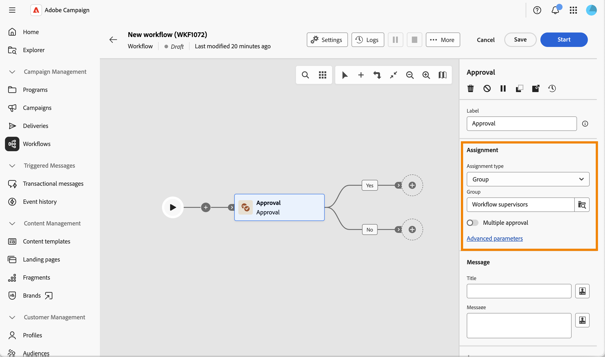
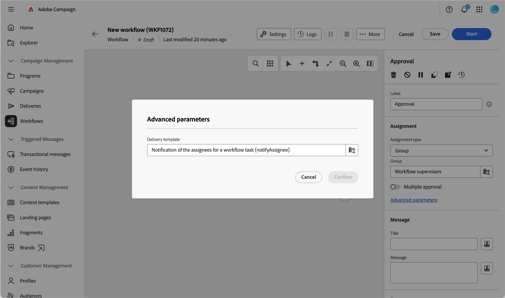
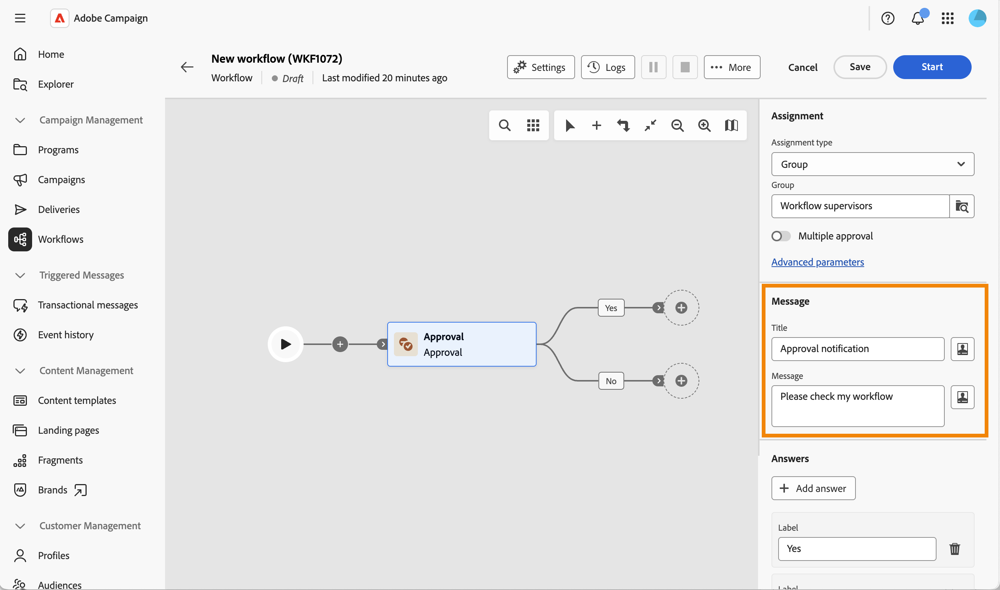
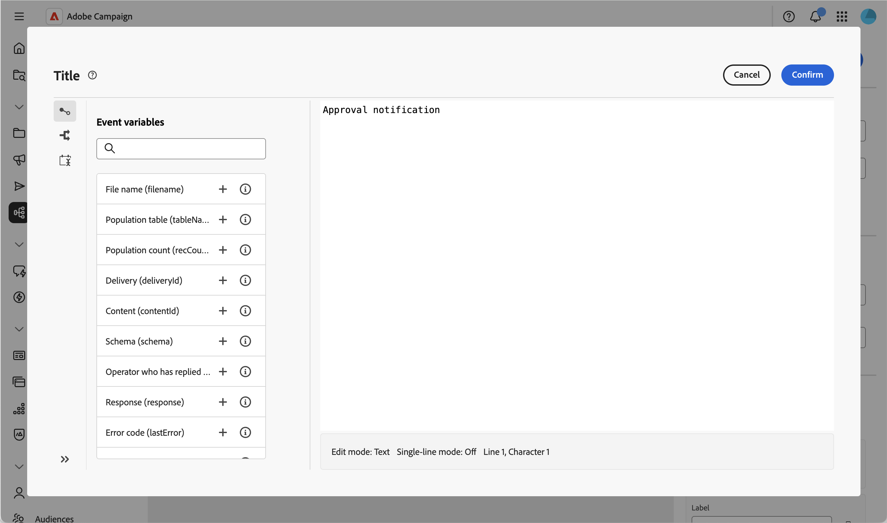
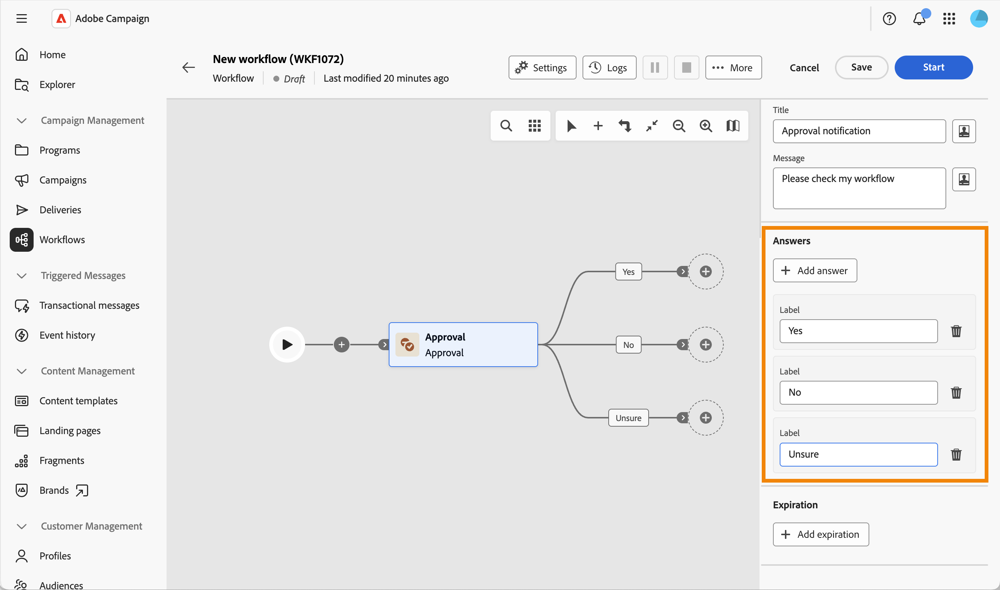
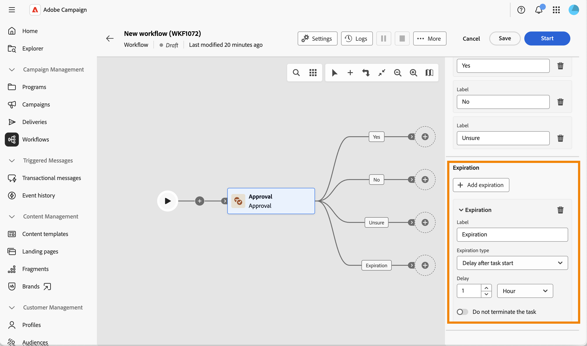

# 승인 {#approval}

>[!CONTEXTUALHELP]
>id="acw_orchestration_approval"
>title="승인 활동"
>abstract="**승인** 활동에는 연산자의 참여가 필요합니다. 작업을 그룹 또는 개별 연산자에 할당하고, 알림 제목과 메시지를 사용자 지정하고, 가능한 답변을 출력 분기로 정의합니다."

**승인** 워크플로우 활동을 통해 그룹 또는 개별 운영자에게 작업을 할당하고, 알림 전자 메일 제목과 메시지를 사용자 지정하고, 가능한 답변(예: 예/아니요)을 출력 분기로 정의할 수 있습니다.

워크플로우의 단계가 계속하기 전에 인간의 의사 결정을 필요로 할 때마다(예: 워크플로우가 진행되기 전에 예산, 타겟 대상자 또는 컨텐츠에 대한 승인을 받기 위해) 이 활동을 사용합니다.

## 승인 프로세스 작동 방식 {#process}

적어도 한 명 이상의 운영자의 참여가 필요하다. 이 활동은 워크플로우를 차단하지 않습니다. 워크플로우가 회신을 기다리는 동안 다른 작업을 실행할 수 있습니다.

답변을 기다리는 동안 활동이 캔버스에 보류 중으로 표시됩니다. 피할당자는 알림 메시지에 포함된 링크를 사용하여 응답합니다.

다음은 승인 작업 프로세스입니다.

1. 워크플로우를 만들고 **승인** 활동을 구성합니다.
1. 워크플로를 시작합니다. **승인** 활동에 도달하면 피할당자에 대한 작업이 만들어집니다.
1. 피할당자가 알림 메시지를 수신하고 링크를 클릭하고 답변을 선택합니다.
1. 할당자가 응답하면 답변과 일치하는 전환을 통해 워크플로우가 계속 진행됩니다.

이 활동을 구성하려면 다음 단계를 수행합니다.

1. 작업 할당, [자세히 보기](#assignment)
1. 알림 메시지를 정의합니다. [자세히 보기](#message)
1. 가능한 답변을 정의하세요. [자세히 보기](#answers)
1. 선택적으로 만료, [자세히 읽기](#expiration)를 정의합니다.

## 작업 할당 {#assignment}

작업을 그룹 또는 운영자에게 할당하려면 필수입니다. 할당하기 전까지는 경고가 표시됩니다.

{zoomable="yes"}

다음 단계를 수행하십시오.

1. **[!UICONTROL 할당 유형]** 필드에서 작업이 **[!UICONTROL 그룹]**(기본값) 또는 **[!UICONTROL 연산자]**&#x200B;에 할당되었는지 여부를 선택합니다.

1. 그런 다음 **[!UICONTROL 그룹]**(연산자) 또는 **[!UICONTROL 연산자]**(단일 연산자)를 선택합니다.

1. 워크플로우를 계속하기 전에 모든 피할당자가 회신하도록 하려면 **[!UICONTROL 여러 승인]**&#x200B;을 사용하도록 설정하십시오. 이 옵션은 할당 유형에 관계없이 사용할 수 있습니다. 비활성화되면 한 명의 피할당자가 답글을 남기는 즉시 워크플로우가 계속되며 해당 답글은 고려되는 답글입니다.

1. 알림에 사용되는 게재 템플릿을 선택하려면 **[!UICONTROL 고급 매개 변수]**&#x200B;를 클릭하십시오. 기본적으로 기본 제공 템플릿이 사용되지만 다른 게재 템플릿을 선택할 수 있습니다.

   {zoomable="yes"}

## 알림 메시지 정의 {#message}

이제 피할당자에게 전송되는 알림 메시지를 정의할 수 있습니다.

{zoomable="yes"}

다음 단계를 수행하십시오.

1. 피할당자에게 전송된 알림의 **[!UICONTROL 제목]**&#x200B;을(를) 정의합니다.

1. 피할당자에게 보내는 알림의 **[!UICONTROL 메시지]**&#x200B;을(를) 정의합니다.

두 필드 모두 개인화를 지원합니다. 개인화 아이콘을 클릭하여 **[!UICONTROL 응답한 연산자]** 및 **[!UICONTROL 응답]**&#x200B;과 같은 이벤트 변수를 삽입합니다. 이 변수들은 워크플로우의 다른 곳에서 다시 사용할 수 있습니다.

{zoomable="yes"}

## 가능한 답변 정의 {#answers}

활동에는 **[!UICONTROL 예]**&#x200B;와(과) **[!UICONTROL 아니요]**, 이렇게 두 개의 기본 답변이 있습니다. 각 답변은 캔버스의 출력 전환에 해당합니다.

{zoomable="yes"}

추가 선택 항목을 정의하려면 **[!UICONTROL 답변 추가]**&#x200B;를 클릭하십시오.

할당자가 응답하면 워크플로우는 선택한 항목과 일치하는 전환을 계속 진행합니다.

## 만료 정의 {#expiration}

마지막으로 승인 작업의 만료를 정의할 수 있습니다. 답변과 마찬가지로 할당자가 기한까지 답변하지 않은 경우 만료가 자체 출력 전환을 트리거합니다.

{zoomable="yes"}

1. **[!UICONTROL 만료 추가]**&#x200B;를 클릭합니다.

1. 해당 출력 전환에 대해 **[!UICONTROL Label]**&#x200B;을(를) 정의합니다.

1. **[!UICONTROL 만료 유형]** 드롭다운에서 다음 옵션 중 하나를 선택합니다.

   * **[!UICONTROL 작업 시작 후 지연]**: 승인 작업이 시작된 후 대기할 지연을 정의합니다.
   * **[!UICONTROL 다음 날짜 이후에 지연]**: 특정 날짜 이후에 대기할 지연을 정의합니다.
   * **[!UICONTROL 날짜 이전으로 지연]**: 특정 날짜 이전으로 대기할 지연을 정의합니다.
   * **[!UICONTROL 스크립트로 계산된 만료]**: 스크립트를 사용하여 만료를 계산하십시오.

1. 승인 작업을 종료하지 않고 만료 전환을 활성화하려면 **[!UICONTROL 작업을 종료하지 않음]**&#x200B;을 사용하도록 설정합니다. 이렇게 하면 피할당자가 나중에 계속 회신할 수 있습니다.

동일한 승인 작업에 대해 여러 만료를 정의할 수 있습니다.

그런 다음 워크플로우를 시작할 수 있습니다. 할당자가 응답하면 답변과 일치하는 전환을 통해 워크플로우가 계속 진행됩니다. [자세히 보기](#process)

## 관련 항목 {#related}

* [워크플로 활동 정보](about-activities.md)
* [승인 프로세스 설정 및 관리](../../campaigns/campaign-approvals.md)
